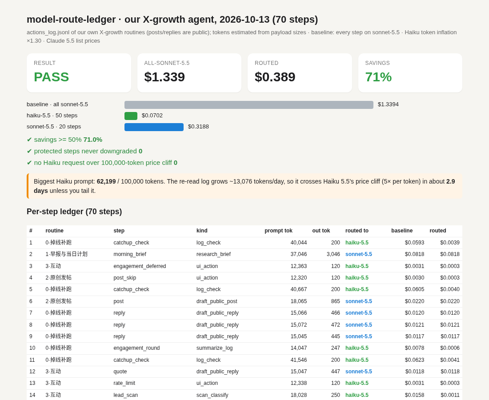
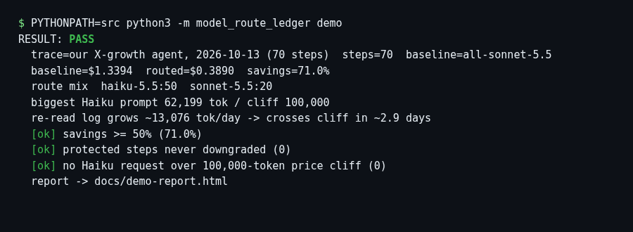

# model-route-ledger

[](https://github.com/BrickerP/model-route-ledger/actions/workflows/ci.yml)

**Before you flip your agent to Haiku 5.5, replay a real day of it.** One command takes an agent trace, routes the cheap steps (UI clicks, scans, log checks, summaries) to Haiku 5.5, keeps public-facing writing on Sonnet, and writes a per-step cost ledger with PASS/FAIL gates, including a forecast of when a growing prompt will cross Haiku 5.5's 100K-token price cliff.



> Built the week Claude Haiku 5.5 shipped (Oct 7, 2026: $0.10 / $0.50 per 1M tokens up to 100K-token prompts, **5× that above 100K**, new tokenizer that counts more tokens). The headline "75% cheaper" is an average; what your agent pays depends on which steps you move and how big their prompts get.

## What we use it for

I run a set of scheduled agent routines for my own X account (engagement rounds, lead scans, hourly catch-up checks, a morning brief, posts). The demo fixture is **one real day of those routines: 70 steps from 2026-10-13**, taken from our own `actions_log.jsonl` (step types and timestamps only, no text). Our runtime doesn't record token usage, so tokens are **estimated** from the real payload sizes (see `src/model_route_ledger/ingest.py`).

What it told us:

- Routing 50 of 70 steps to Haiku 5.5 cuts the day from **$1.339 to $0.389 (71%)** against an all-Sonnet-5.5 baseline. Every public reply and post stays on Sonnet.
- Our hourly catch-up check re-reads the whole action log. Its biggest prompt is already **62K Haiku tokens**, and the log grows ~13K tokens a day, so it would hit the 100K price cliff in **about 3 days**.
- Tailing the log (`--log-window 20000`) removes the cliff risk entirely and still saves 65%.

## Try it (under 2 minutes)

Stdlib Python 3.10+. No install, no API keys, no network.

```bash
git clone https://github.com/BrickerP/model-route-ledger.git
cd model-route-ledger
PYTHONPATH=src python3 -m model_route_ledger demo
```



Open `docs/demo-report.html` for the full per-step ledger. Exit code is 0 on PASS and 1 on FAIL, so you can run it in CI.

## Your own agent

Trace JSON (if your runtime logs real usage, this is the best input):

```json
{"name": "my agent", "steps": [
  {"ts": "2026-10-13T09:00:00+08:00", "kind": "scan_classify", "input_tokens": 6200, "cached_tokens": 12000, "output_tokens": 250},
  {"ts": "2026-10-13T09:01:00+08:00", "kind": "draft_public_reply", "input_tokens": 3100, "cached_tokens": 12000, "output_tokens": 480}
]}
```

```bash
PYTHONPATH=src python3 -m model_route_ledger run my_trace.json --report out.html
PYTHONPATH=src python3 -m model_route_ledger run my_trace.json --baseline opus-5.5 --min-savings 0.6
```

Or straight from an agent action log (JSONL with `ts`, `type`, `text`, `routine`):

```bash
PYTHONPATH=src python3 -m model_route_ledger from-log actions_log.jsonl --day 2026-10-13 \
  --log-window 20000 --save-trace trace.json --report out.html
```

Routing lives in `fixtures/policy.json`: step kind to model, a `never_downgrade` list for steps where quality is the product, and the Haiku cliff limit.

## Gates

| gate | why |
|---|---|
| savings ≥ `--min-savings` (default 50%) | routing that saves little isn't worth the quality risk |
| protected steps never downgraded | public writing, research, and code stay on the stronger model |
| no Haiku request over 100K prompt tokens | above the cliff the whole request costs 5× per token, cache reads included |

## Pricing assumptions

Claude 5.5 list prices from [Anthropic's pricing page](https://platform.claude.com/docs/en/about-claude/pricing), checked 2026-10-13: Opus $4/$20, Sonnet $2/$10 (cache read $0.10), Haiku $0.10/$0.50 (cache read $0.01) up to 100K-token prompts and $0.50/$2.50 (cache read $0.05) above. Opus cache read is assumed at 0.1× input. Haiku token inflation defaults to ×1.30 for the new tokenizer; set `--haiku-inflation 1.0` if your token counts already come from Haiku 5.5. All prices live in `src/model_route_ledger/pricing.py`.

## Development

```bash
PYTHONPATH=src python3 -m unittest discover -s tests -v
```

## Author

Built by Yupeng Lu, AI agent & backend engineer. I take agents from demo to production: MCP tools, guardrails, evals, billing, real-time systems.

**Hire me:** https://brickerp.github.io/hire/

MIT License.
